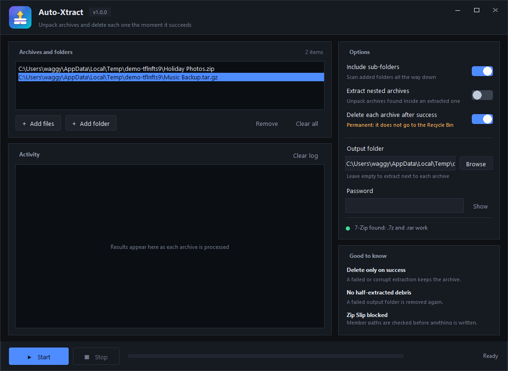
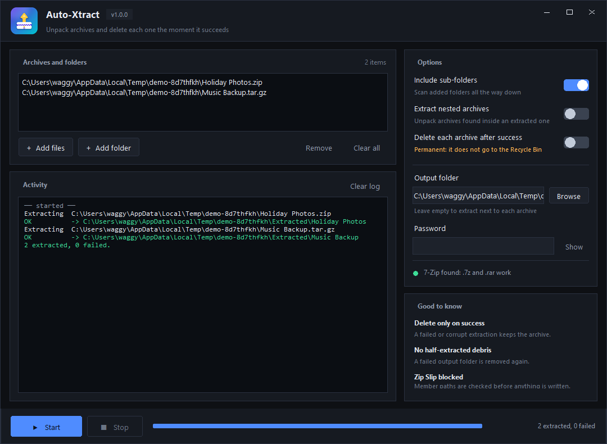

# Auto-Xtract

A small desktop tool that unpacks your archives and deletes each archive the moment it has been extracted successfully. Point it at a folder, hit Start, and you are left with only the files you wanted and none of the archives you did not.

Written in Python with Tkinter. Standard library only for the common formats, so there is nothing to install unless you want `.7z` or `.rar`.


---

## Why

Archive hoarders end up with a folder full of `.zip` files next to a folder full of extracted copies of the same thing. Auto-Xtract closes that loop: it extracts, verifies, then deletes the source archive. If extraction fails, the archive is kept and the half-written output folder is removed, so nothing is ever lost silently.

## Features

- **Extract and delete in one pass.** Each archive is deleted only after its extraction reports success.
- **Folder or file input.** Add individual archives, whole folders, or a mix. Folders can be scanned recursively.
- **Nested archives.** Optionally detect archives that came out of an archive and extract those too.
- **Name collisions handled.** A second `photos.zip` becomes `photos_1`, then `photos_2`, never a silent overwrite.
- **Password support.** One password applies to the whole run (`.zip`, `.7z`, `.rar`).
- **Zip Slip protection.** Member paths are checked before anything is written, so a malicious archive cannot escape the output folder.
- **Stoppable.** The Stop button finishes the current file and stops cleanly, leaving the queue untouched.
- **Live log with colour-coded results** and a progress bar for the run.
- **Dark interface.** A flat dark theme, including its own title bar, so it never clashes with a light window frame.
- **Standalone `.exe`** included, no Python required on Windows.






## Supported formats

| Format | Extensions | Needs |
| --- | --- | --- |
| Zip | `.zip` | nothing |
| Tar | `.tar`, `.tar.gz`, `.tgz`, `.tar.bz2`, `.tbz2`, `.tar.xz`, `.txz` | nothing |
| Single stream | `.gz`, `.bz2`, `.xz` | nothing |
| 7-Zip | `.7z` | 7-Zip installed, or `pip install py7zr` |
| RAR | `.rar` | 7-Zip installed, or `pip install rarfile` plus `unrar` |

7-Zip is found automatically: `7z`, `7zz` or `7za` on `PATH`, otherwise `C:\Program Files\7-Zip\7z.exe` or `C:\Program Files (x86)\7-Zip\7z.exe`. If it is present it is preferred over the Python libraries. The GUI tells you which case you are in as soon as it opens.

## Install and run

### Option 1: the installer (Windows, recommended)

Download `AutoXtract-<version>-Setup.exe` from [Releases](https://github.com/waggynotfound/auto-xtract/releases) and run it. It installs into `Program Files`, adds a Start Menu entry, lists itself in Apps & features and uninstalls cleanly. Pick "Install for me only" on the privileges page to install into `%LOCALAPPDATA%\Programs` without admin rights.

### Option 2: the portable executable (Windows)

Download `AutoXtract.exe` from [Releases](https://github.com/waggynotfound/auto-xtract/releases), or `XTract.exe` from this repository (the same program, under its build name) and run it. Nothing else is needed.

### Option 3: from source

```bash
git clone https://github.com/waggynotfound/auto-xtract.git
cd auto-xtract
python auto_extract_gui.py
```

On Windows, rename `auto_extract_gui.py` to `auto_extract_gui.pyw` to start it without the black console window behind it. The included `.exe` is already console-free.

Optional extras:

```bash
pip install py7zr rarfile
```

### Requirements

- Python 3.9 or newer (3.12+ recommended, it enables Tar's built-in `data` extraction filter)
- Tkinter, which ships with the python.org installers. On Debian or Ubuntu: `sudo apt install python3-tk`
- The window draws its own dark title bar so the frame matches the app on every platform; DPI awareness is turned on at startup for sharp text on Windows

## Usage

1. **Add what you want unpacked.** `Add files` for individual archives, `Add folder` for a directory of them. `Remove` and `Clear all` manage the list (select an entry and press <kbd>Del</kbd> too).
2. **Set the options.** Toggle the switches on the right; see the table below.
3. **Choose an output folder**, or leave it empty to extract next to each archive.
4. **Type a password** if the archives are encrypted. `Show` reveals what you typed.
5. **Start.** If deletion is enabled you get one confirmation dialog first, because the delete is permanent.
6. **Watch the log.** Green `OK` lines show where each archive went, purple `Deleted` lines confirm the source is gone, red `FAILED` lines keep the archive.

Each archive is extracted into a folder named after the archive itself, without its extension: `photos.tar.gz` becomes `photos/`. A single-file `.gz` or `.xz` has no folder of its own, so the decompressed file is written straight into the destination (`backup.sql.gz` becomes `backup.sql`).

### Options

| Option | Default | What it does |
| --- | --- | --- |
| Include sub-folders when a folder is added | On | Scan the added folder recursively instead of its top level only |
| Also extract archives found inside extracted archives | Off | After extracting, scan the new output folder for more archives and queue them |
| Delete each archive after it is extracted successfully (permanent) | On | Unlink the source archive. Goes to nowhere, not the Recycle Bin |
| Output folder | empty | Where folders are created. Empty means next to each archive |
| Password | empty | Passed to zip, 7-Zip and RAR. Leave empty for unencrypted archives |

### What the log tags mean

| Tag | Colour | Meaning |
| --- | --- | --- |
| `Extracting` | default | Archive started |
| `OK` | green | Extraction succeeded, this is the output folder |
| `FAILED` | red | Extraction threw an error, archive kept, partial folder removed |
| `Could not delete` | orange | Extraction worked but the archive could not be removed (locked or read-only) |
| `[skip]` | orange | Path missing or unsupported type |
| `Deleted` | purple | Source archive removed |

The run ends with `Finished: N extracted, M failed.` and the progress bar fills completely.

## Safety behaviour

Auto-Xtract deletes real files. These are the guarantees the code makes:

- **Delete only after success.** A failure, an exception, a bad password or a non-zero exit code from 7-Zip leaves the archive exactly where it was.
- **Partial output is rolled back.** On failure the freshly created output folder is removed with `rmtree`, so you do not get half-extracted debris.
- **Path traversal is blocked.** Every member name is resolved against the output folder before writing. A member that escapes it raises `Unsafe path in archive` and counts as a failure.
- **No overwrite prompts.** 7-Zip is called with `-y` and the Python extractors write into a folder that was just created for this one archive.
- **Only exit code 0 counts as success** from 7-Zip, so warnings never trigger a delete.
- **A confirmation dialog appears before the first delete** of every run. Cancel it and nothing happens.
- **Stop is graceful.** It sets an event and the current archive finishes first.

Deletion is permanent. There is no Recycle Bin, no trash, no undo. If you want a trial run, untick the delete option and compare the output folders against their archives yourself.

## Using it from Python

The extraction core is importable without a display:

```python
import threading
from pathlib import Path
from auto_extract_gui import run_extraction

done, failed, stopped = run_extraction(
    paths=[Path("D:/Downloads")],   # files, folders, or both
    output="",                      # "" = next to each archive
    password="",                    # "" = unencrypted
    keep=False,                     # False = delete archives after success
    recursive=True,                 # scan added folders recursively
    nested=False,                   # also extract archives found inside
    log=lambda text, tag="info": print(tag, text),
    progress=lambda done, total: None,
    stop=threading.Event(),         # .set() to stop after the current file
)
```

Lower-level helpers are exposed too:

- `archive_ext(path)` returns the matched extension or `None`
- `archive_stem(path)` strips that extension from the name
- `extract_archive(path, dest, pwd=None)` extracts a single archive into `dest`
- `find_archives(folder, recursive)` lists supported archives in a folder
- `find_7zip()` returns the 7-Zip path or `None`

`auto_extract.py` is a byte-for-byte copy of `auto_extract_gui.py`, kept so either filename works. Import whichever one you like.

## Building a release

`build_release.ps1` builds everything a release needs and puts it in `dist\`:

```powershell
powershell -ExecutionPolicy Bypass -File .\build_release.ps1
```

That produces `AutoXtract.exe`, `AutoXtract-<version>-Setup.exe` (Inno Setup), a portable zip and `SHA256SUMS.txt`. The version comes from the `VERSION` file; override it with `-Version 1.2.3`. It needs Python with PyInstaller and [Inno Setup 6](https://jrsoftware.org/isdl.php). Pushing a `v*` tag runs the same script on GitHub Actions and attaches the files to a draft release (`.github/workflows/release.yml`).

### Just the executable

`build_exe.bat` does it in one step on Windows:

```bat
build_exe.bat
```

It runs PyInstaller with the icon and both files bundled, and leaves the result in `dist\AutoExtract.exe`:

```bat
python -m PyInstaller --clean --noconfirm --onefile --noconsole ^
  --name=AutoExtract --icon=app_icon.ico ^
  --add-data=app_icon.ico:. auto_extract_gui.py
```

`--onefile` makes a single portable executable, `--noconsole` hides the terminal, and `--add-data` puts `app_icon.ico` inside the bundle where the app looks for it at runtime.

## Troubleshooting

| Symptom | Fix |
| --- | --- |
| Log says `7-Zip not found` | Install from [7-zip.org](https://7-zip.org), or `pip install py7zr rarfile`. Without either, `.7z` and `.rar` fail and the archive is kept |
| `Tkinter is not available in this Python installation` | Your Python was built without Tk. Install `python3-tk` (Linux) or use the python.org installer (Windows, macOS) |
| A black console window appears behind the app | Rename the script to `.pyw` on Windows, or use `AutoXtract.exe` |
| The window has no normal title bar | By design: Auto-Xtract draws its own dark bar. Drag it to move, double-click it to maximise, or drag any window edge to resize |
| Archive kept with a `FAILED` line | The message after the colon is the real error: wrong password, corrupt archive, or an unsupported compression method |
| Folders named `photos_1`, `photos_2` | The output already existed. Rename or clear the old folder and rerun |
| Stop seems slow | It waits for the current archive to finish. The status bar says `Stopping after the current file…` |
| Files vanished after a run | The delete option was on. This is permanent and by design |

## Repository layout

```
auto-xtract/
├── auto_extract_gui.py     main application (extraction core and dark GUI)
├── auto_extract.py         identical copy of the above
├── VERSION                 release version used by the build and installer
├── app_icon.ico            window, taskbar and .exe icon
├── assets/icon-48.png      icon shown in the app's title bar
├── app_icon_preview.png    preview of the icon
├── installer/setup.iss     Inno Setup script (installer, Start Menu, uninstaller)
├── packaging/version_info.template.txt   file properties embedded in the .exe
├── build_release.ps1       full release build (exe, installer, zip, checksums)
├── build_exe.bat           one-click PyInstaller build (exe only)
├── .github/workflows/release.yml   CI that publishes a tagged release
├── CHANGELOG.md
└── README.md
```
